<picture><source media="(prefers-color-scheme: dark)" srcset="assets/enso-dark.svg"></picture>

<picture><source media="(prefers-color-scheme: dark)" srcset="assets/ficha-dark.svg"></picture>

<picture><source media="(prefers-color-scheme: dark)" srcset="assets/inventario-dark.svg"></picture>

<picture><source media="(prefers-color-scheme: dark)" srcset="assets/stats-dark.svg"></picture>

